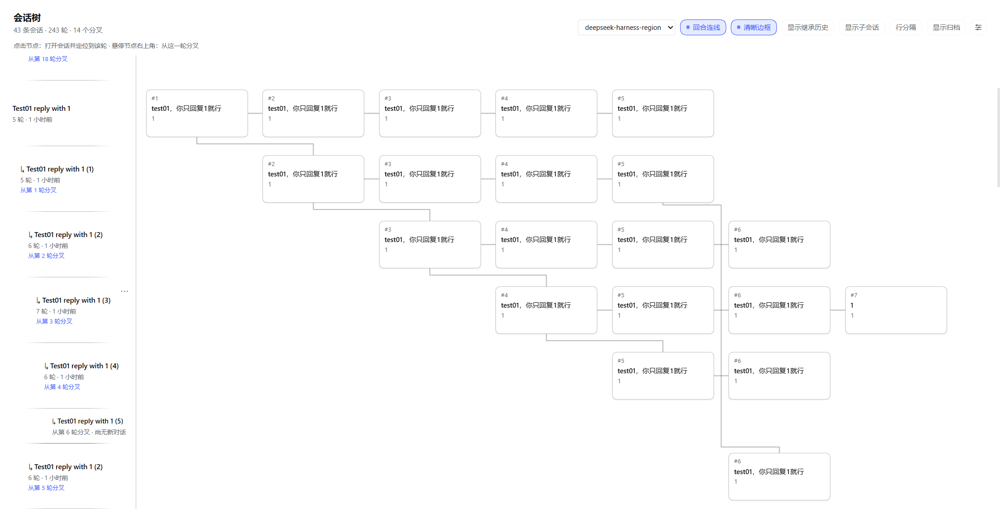
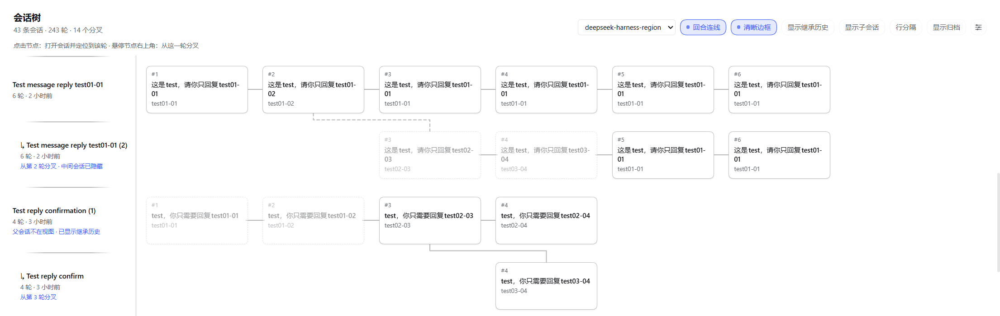

<h1 align="center">dsh-session-tree</h1>

<p align="center">A per-workspace map of DeepSeek Harness sessions, turns and fork branches in the Web UI</p>

<p align="center">
  <a href="LICENSE"></a>
  
</p>

<p align="center">
  <a href="README.md">中文说明</a>
</p>

> A DeepSeek Harness bundle. It never changes the session format, copies conversations, or stores extra chat data; it only reads the session projections DSH already computes.
>
> **Entry point**: left sidebar icon column in the DSH Web UI (after Plugins and Schedules) → tree icon → full-page **Session Tree**.



## Why

When you branch off mid-conversation, DSH's session list stays linear: forks get buried, it is hard to see which turn a branch came from, and the original main line gets lost. Session Tree draws sessions, turns and forks as one browsable map.

## Design philosophy

Session Tree takes **one turn** — not a whole session — as the smallest unit of the graph:

- **One prompt + one reply = one conversation node.** A node carries that turn's excerpt and is the unit you read, locate and fork from;
- **One session = one row**, made of its nodes in chronological order. A column means "turn N" for every session, so the columns advance as the conversation advances;
- **A fork = an edge from a turn's node into a new row.** History the new session inherited from its parent is still drawn on the original columns and shown faded/dashed, so inherited turns are distinguishable from turns the row produced itself;
- **Sub-sessions and archived sessions are just special rows in the same coordinate system** — no second history, no copied conversation.

Read horizontally, you see the conversation advancing; read vertically, you see branches growing. One screen answers both "how far did we get" and "where did this branch come from".

## Features

| Capability | Description |
|---|---|
| One map per workspace | Switch workspaces from the page header; defaults to the most recently active one. |
| One row per session, one column per turn | Every session is a row of its conversation nodes, each node showing the prompt / reply excerpt for that turn. |
| Fork lines | Fork edges start at the exact turn they were cut from; hidden intermediate sessions reconnect to the nearest visible ancestor with a dashed link. |
| Inherited history | When a parent is not in view, the branch shows its inherited history inline (faded) instead of dangling. |
| Sub-sessions | A sub-agent hangs under the turn that spawned it as a small chained node; collapsed, that turn shows a count badge. |
| Archived sessions | Toggle "Archived": archived rows get a tinted row, a chip and dimmed nodes. |
| Row menu | Rename, pin/unpin, fork, archive/unarchive, copy Session ID. |
| Click to locate | Clicking a node opens the session and locates that turn, with a short flash. |



## Where it appears

After installing (and restarting or refreshing), a **tree icon appears in the left sidebar's icon column**, after Plugins and Schedules. Clicking it switches the main area to the full **Session Tree** page — it is not an overlay inside the conversation page and does not change that page.

The page has three parts:

- **Header**: workspace picker plus the view toggles;
- **Left label column**: one row per session, with turn count, last activity and fork origin (for example "forked from turn 3");
- **Graph area**: columns advance turns, rows grow branches; hovering a node's top-right corner forks from that turn.

## Install

### Requirements

- DeepSeek Harness **0.2.x** (Web UI; the `web` profile or the desktop app's `desktop` profile).
- Plain JavaScript, no build step and no `install`/`prepare` scripts, so a GitHub install does **not** require granting pnpm build-script permission.

```powershell
dsh --version
```

### Option A: from GitHub (recommended)

```powershell
# Pin the release tag
dsh plugin --profile web add github:lulaalu/dsh-session-tree#v0.1.0

# Or pin the exact commit
dsh plugin --profile web add github:lulaalu/dsh-session-tree#dbc85c5
```

Use `--profile desktop` for the desktop app. The plugin manager / agent equivalent is:

```text
plugin_manager install_bundle target="github:lulaalu/dsh-session-tree"
```

### Option B: local checkout (development)

```powershell
dsh plugin --profile web add D:\path\to\dsh-session-tree
```

This is a pnpm `link:` install: files are not copied, the profile only records a directory link. After editing, let the Host re-read the bundle (disable and re-enable the plugin row) and refresh the page.

### Option C: tarball

```powershell
pnpm pack
dsh plugin --profile web add .\dsh-session-tree-0.1.0.tgz
```

### Uninstall

```powershell
dsh plugin --profile web remove dsh-session-tree
```

### Where did the panel go?

1. A tree icon appears in the left sidebar's icon column, after Plugins and Schedules; see [Where it appears](#where-it-appears).
2. Restart the desktop app, or restart `dsh web` and refresh the page after a CLI install.
3. The usual mistake is installing into the other profile: the desktop app and the CLI each use their own (`desktop` vs `web`).

## Usage

- Header toggles: `Inherited history` · `Sub-sessions` · `Archived` · `Turn links` · `Row separators` · `Strong outlines`; the gear sets the accent color.
- Nodes: click to locate that turn; hover the top-right corner ⑂ to fork from it; the row menu `⋯` manages the session (rename / pin / fork / archive / copy ID).
- Label column: drag its right edge to resize.

## Data and boundaries

- Reads `ctx.sessions` list state and projections (`turnOutline`) only. It never touches session files or the session format.
- Fork lineage comes from the existing session header fields `parentSession` / `isSeeded`; sub-sessions come from `origin === 'subagent'`. No second relation store.
- Session content stays owned by DSH's own session log; the plugin stores no conversation text.
- The only browser-local writes are the accent color (localStorage) and the label width for the current page.
- The Host half (`index.js`) is an empty `apply()`; all UI lives in the client half.

## Known limitations

- Sub-agents that start a fresh timeline are attached to the parent's latest turn: DSH does not expose the spawn turn to clients. Context-inheriting sub-agents align exactly.
- Locating a turn is best effort (paged history plus a DOM anchor); very old turns may not be reached and no error is surfaced.
- More than three long connectors sharing one column gutter reuse lanes and may overlap in extreme trees.
- No search, export or batch operations yet; deeper sub-agent conversations stay as mini nodes instead of full timelines.

## Roadmap

**LLM summaries for individual conversation nodes** (planned, not part of v0.1.0)

A node currently shows the raw prompt / reply excerpt for its turn — complete, but slow to scan. The next step is to let an LLM summarize a node into a sentence or a few key points, so long sessions and sibling branches can be reviewed and compared quickly.

The form is still open:

- **Summarize on demand**: select one or more nodes and generate summaries on request — predictable cost, no model calls until you ask;
- **Summarize after every turn**: automatic and effortless, but adds a standing model call and needs a rule for when a summary goes stale or is regenerated.

Either way, a few things must be decided first: which model to use (the conversation's current model or a dedicated one), where the summary lives (plugin-local derived data, never written into the session log), and how to cache and delete it without breaking the read-only session boundary.

If you have a preference for the form, feel free to discuss it in [Issues](https://github.com/lulaalu/dsh-session-tree/issues).

## Development

```powershell
npm run check       # syntax checks
npm test            # render smoke test: real client.js against a stub React, 17 scenarios
npm run test:layout # read-only geometry diagnosis against real DSH data
```

`test:layout` accepts `DSH_HOME`, `SESSION_TREE_PROJECT`, `SESSION_TREE_CWD` and `SESSION_TREE_SESSION`.

Local iteration loop: edit, disable and re-enable the `include:session-tree` plugin row so the Host re-reads the bundle, then refresh the page.

## Layout

```text
.
├── package.json        # npm package + dsh.bundle / dsh.client
├── cordis.patch.yml    # bundle layer: inserts the session-tree row
├── index.js            # Host half (empty apply)
├── client.js           # entire Web client UI (plain JS, no build)
├── locale/             # display metadata (en/zh)
├── icon.svg
├── docs/images/        # README screenshots
├── test/               # render smoke test + real-data geometry diagnosis
└── .github/workflows/  # CI: syntax checks + smoke test
```

## Compatibility

`package.json` declares `engines.dsh = ">=0.2.0 <0.3.0"`. DSH validates it on install and startup (prereleases participate in the range).

## License

[MIT](LICENSE)
