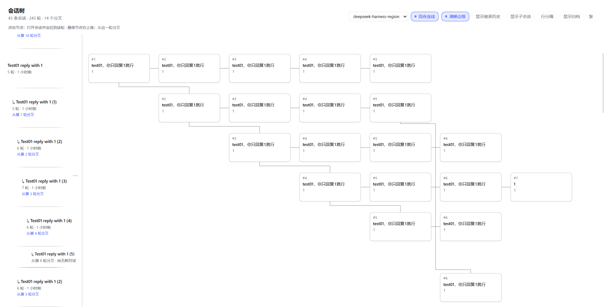
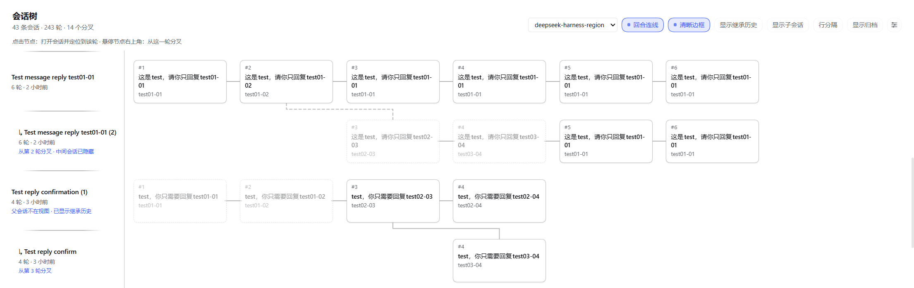

<h1 align="center">dsh-session-tree</h1>

<p align="center">DeepSeek Harness 的会话树：把同一工作区的会话、每一轮对话和分叉画成一张可浏览的地图</p>

<p align="center">
  <a href="LICENSE"></a>
  
  
</p>

<p align="center">
  <a href="README.en.md">English guide</a>
</p>

> 这是一个 DSH 插件（bundle）。它不修改 session 格式、不复制会话内容、不额外存储对话；只读取 DSH 已有的会话投影来画图。
>
> **入口**：DSH Web 左侧边栏图标列（Plugins、Schedules 之后）→ 树形图标 → 主区域整页「会话树」。



## 为什么做它

在对话里发散思考时，你经常会从某一轮分叉出一个新会话继续追问；新会话又可能再分叉。DSH 的会话列表是线性的，分支多了以后：

- 找不到当初是从哪一轮分出去的；
- 忘记原本的主线；
- 旧会话被淹没在后面，越翻越乱。

Session Tree 把「会话 → 每一轮对话 → 分叉」画成一张地图，让分支关系一眼可见。

## 设计理念

会话树把**一轮对话**——而不是整个会话——作为图的最小单位：

- **一次 prompt + 一次回复 = 一个对话节点**。节点只承载这一轮的摘要，是阅读、定位和分叉的最小单位；
- **一个会话 = 一行**，由按时间顺序排列的对话节点组成。同一列表示各会话的「第 N 轮」，所以列在推进就是对话在推进；
- **分叉 = 从某一轮的节点连出新的一行**。新会话复制自父会话的那段历史仍然画在原来的列上，并用虚线/淡显标注「这是继承来的」，从而和它自己产生的对话区分开；
- **子会话、归档会话是同一坐标系里的特殊行**，不另造一套历史，也不复制会话内容。

于是横向看是对话在推进，纵向看是分支在生长——一屏同时回答「聊到哪了」和「从哪分出去的」。

## 功能

| 能力 | 说明 |
|---|---|
| 按工作区一张图 | 页面顶部下拉切换工作区，默认停在最近活跃的工作区。 |
| 一行一会话、一列一轮 | 每个会话一行，按时间顺序排列它的对话节点，节点上显示这一轮的 prompt / 回复摘要。 |
| 分叉可视化 | 从被切出的那一轮连线到新会话；中间会话被隐藏时重连到最近的可见祖先，用虚线标示。 |
| 继承历史 | 父会话不在视图时，子会话就地淡显它继承来的历史，不会凭空断开。 |
| 子会话 | 子会话以迷你节点挂在调用它的那一轮下方，依次串成链；收起时该轮节点显示数量徽标。 |
| 归档会话 | 「显示归档」打开后，归档行用浅灰底 + 胶囊 + 降低不透明度的节点区分。 |
| 节点操作 | 行内「⋯」菜单：重命名、置顶 / 取消置顶、分叉、归档 / 取消归档、复制 Session ID。 |
| 点击定位 | 点任意节点：打开该会话并定位到那一轮，闪一下高亮。 |



## 它出现在哪

装好并重启 / 刷新后，DSH Web **左侧边栏的图标列**（Plugins、Schedules 图标之后）会多出一个**树形图标**；点它，右侧主区域**整页切换**到「会话树」。它不是对话页里的浮层，也不会改动对话页面本身。

页面分三块：

- **顶部**：工作区下拉（选择要看哪个工作区）+ 视图开关；
- **左侧名字列**：每个会话一行，标出轮次数、最近时间和分叉来源（例如「从第 3 轮分叉」）；
- **右侧图区**：横向是轮次推进，纵向是分支；悬停节点右上角可以从那一轮分叉。

## 安装

### 要求

- DeepSeek Harness **0.2.x**（Web UI；`web` profile 或桌面 App 的 `desktop` profile 都可以）。
- 本插件是**纯 JavaScript**，没有构建步骤、没有 `install`/`prepare` 脚本——从 GitHub 安装**不需要**给 pnpm 授权运行构建脚本。

先确认 `dsh` 可用：

```powershell
dsh --version
```

### 方式 A：从 GitHub 安装（推荐）

```powershell
# 固定到标签（当前发布版本）
dsh plugin --profile web add github:lulaalu/dsh-session-tree#v0.1.0

# 或固定到具体提交，最严格
dsh plugin --profile web add github:lulaalu/dsh-session-tree#dbc85c5
```

桌面 App 用 `--profile desktop`。也可以在 DSH 的插件页面（或让 Agent 调 `plugin_manager`）用包 spec 安装：

```text
plugin_manager install_bundle target="github:lulaalu/dsh-session-tree"
```

### 方式 B：本地目录（开发用）

```powershell
dsh plugin --profile web add D:\path\to\dsh-session-tree
```

等价的 GUI/Agent 方式：`plugin_manager install_bundle target="D:\path\to\dsh-session-tree"`。

这是 pnpm 的 `link:` 安装：**不复制文件**，profile 里只登记一个目录联接。改代码后需要让 Host 重新读取 bundle（禁用/启用插件行）并刷新页面。

### 方式 C：tarball

```powershell
pnpm pack
dsh plugin --profile web add .\dsh-session-tree-0.1.0.tgz
```

### 卸载

```powershell
dsh plugin --profile web remove dsh-session-tree
```

### 装完找不到入口？

1. 先在左侧边栏图标列（Plugins、Schedules 之后）找到**树形图标**，详见上文[「它出现在哪」](#它出现在哪)。
2. 桌面 App 安装后需要**重启 App**；命令行安装后重启 `dsh web` 并刷新页面。
3. 最常见的原因是**装到了另一套 profile**：桌面 App 和命令行各用一套，把 `--profile` 换成另一套再装一次。

## 使用

- **顶部开关**：`显示继承历史` · `显示子会话` · `显示归档` · `回合连线` · `行分隔` · `清晰边框`；右侧 ⚙ 可调强调色。
- **节点**：点击定位到那一轮；悬停右上角 ⑂ 从这一轮分叉；行内「⋯」管理会话（重命名 / 置顶 / 分叉 / 归档 / 复制 ID）。
- **名字列**：拖右边缘可调整宽度。

## 数据与边界

- 只读 `ctx.sessions` 的会话列表与投影（`turnOutline`），**不读写 session 文件、不改 session 格式**。
- 分叉关系来自 DSH 会话 header 里已有的 `parentSession` / `isSeeded`，子会话来自 `origin === 'subagent'`；插件不维护第二份关系表。
- 会话内容始终以 DSH 原生 session log 为唯一事实来源；插件不保存任何对话正文。
- 唯一写到浏览器本地的是强调色（`localStorage`）与本次会话内的列宽；删掉不影响任何会话。
- Host 半（`index.js`）只有一个空的 `apply()`，全部 UI 都在 Web 客户端半边。

## 已知限制

- **全新子会话的精确轮次**：DSH 没有向客户端暴露 subagent 的 spawn 时刻轮次，所以这类子会话暂时挂在父会话**当前最后一轮**下方；继承上下文的子会话能精确对齐到被切出的那一轮。
- **定位到某一轮是「尽力而为」**：DSH 没有公开的「滚动到某轮」接口，插件用 `loadThrough(seq)` 翻页 + 对话区 DOM 锚点滚动；历史特别长时可能翻不到，且不会报错。
- **跨行连线**：同一列间空隙里超过 3 条长连线时会复用车道，极端情况下可能重叠。
- 暂无搜索、导出、多选批量操作；子会话内部更深层的对话以迷你节点表示，不展开成完整时间线。

## 下一步

**给单个对话节点做 LLM 总结**（规划中，v0.1.0 尚未包含）

节点上现在显示的是这一轮 prompt / 回复的原文摘录——信息完整，但扫读不够快。下一步计划接入 LLM，为对话节点生成简短总结（一句话或几条要点），用于快速回顾和跨分支对比。

具体形式还在权衡：

- **按需选择**：勾选若干节点后统一生成总结，成本可控，只在你需要时调用模型；
- **每轮结束后统一生成**：自动、无感，但会引入常驻的模型调用，还要处理总结何时失效、是否重算。

无论哪种形式，都需要先定清楚：用哪个模型（复用会话当前模型还是单独指定）、总结存在哪里（作为插件的本地派生数据，不写 session log）、以及怎样在不破坏「只读会话」边界的前提下缓存和删除。

如果你对形式有偏好，欢迎在 [Issues](https://github.com/lulaalu/dsh-session-tree/issues) 里讨论。

## 开发

```powershell
# 语法检查
npm run check

# 渲染冒烟测试：用桩 React + 桩客户端上下文跑真实 client.js，覆盖 17 个场景
npm test

# 真实数据几何诊断（只读）：检查连线是否穿卡片 / 共线重叠
npm run test:layout
```

`npm run test:layout` 会读取本机 DSH 数据，可用环境变量指定范围：

| 环境变量 | 含义 |
|---|---|
| `DSH_HOME` | DSH 数据目录，默认 `~/.dsh` |
| `SESSION_TREE_PROJECT` | `sessions/` 下的项目目录名，默认取会话最多的项目 |
| `SESSION_TREE_CWD` | 要诊断的工作区路径，默认取会话最多的工作区 |
| `SESSION_TREE_SESSION` | 用于打印行上下文的会话 id，默认取回合最多的会话 |

本地开发循环：

```powershell
# 1) 改代码后重新让 Host 读取 bundle（禁用再启用插件行）
plugin_manager set_plugin target="include:session-tree" enabled=false
plugin_manager set_plugin target="include:session-tree" enabled=true

# 2) 刷新浏览器页面，加载新的 client bundle
```

## 仓库结构

```text
.
├── package.json        # npm 包 + dsh.bundle / dsh.client 声明
├── cordis.patch.yml    # bundle 层：插入 session-tree 这一行
├── index.js            # Host 半（空 apply）
├── client.js           # Web 客户端全部 UI 与逻辑（纯 JS，无构建）
├── locale/en.json      # 插件显示元数据（英文）
├── locale/zh.json      # 插件显示元数据（中文）
├── icon.svg            # 插件图标
├── docs/images/        # README 截图
├── test/               # 冒烟测试 + 真实数据几何诊断
└── .github/workflows/  # CI：语法检查 + 冒烟测试
```

## 兼容性

`package.json` 声明 `engines.dsh = ">=0.2.0 <0.3.0"`。DSH 在安装和启动时会校验该范围（预发布版本也参与匹配）；不满足时会拒绝加载并提示用 `dsh plugin allow-version` 豁免。

## 许可证

[MIT](LICENSE)
